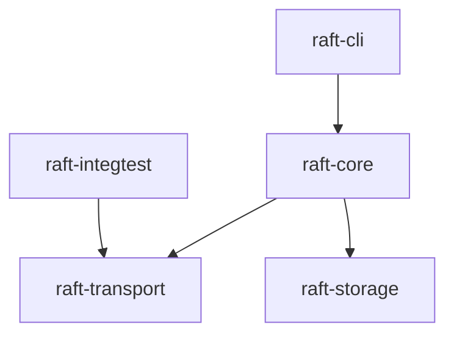
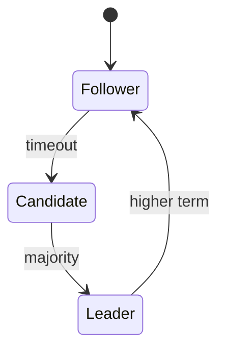

# Raft Consensus

Raft in Java 21. The algorithm is pure: no I/O, no threads, no clocks. Transport, storage, and tooling are separate modules that plug in around it.





## Quickstart

```bash
git clone https://github.com/pdj555/raft-consensus.git
cd raft-consensus
mvn clean verify
```

## What it does

- **Pure core.** `raft-core` implements the Raft state machine with zero I/O. Election timers, log replication, and commit advancement are all driven by explicit inputs. Testable without a network.
- **Netty transport.** `raft-transport` handles RPC encoding and delivery over Netty. The core never sees a socket.
- **Durable storage.** `raft-storage` persists the log as memory-mapped segments with snapshotting. Crash recovery replays from the last snapshot.
- **Admin and stress tools.** `raft-cli` ships cluster administration and load generation. `raft-integtest` runs wire-level tests against real sockets.

## Module layout

```text
raft-core/       Algorithm — no I/O
raft-transport/  Netty + codecs
raft-storage/    Log segments + snapshots
raft-cli/        Admin + stress tools
raft-integtest/  Wire-level tests
```

JUnit 5, AssertJ, TestContainers. Checkstyle and SpotBugs enforced.

Further reading: [docs/design.md](docs/design.md) · [docs/constitution.md](docs/constitution.md) · [docs/adr/](docs/adr/)

## Reference

```bash
mvn test -DskipITs=true
mvn checkstyle:check
mvn spotbugs:check
```

MIT · [LICENSE](LICENSE)
